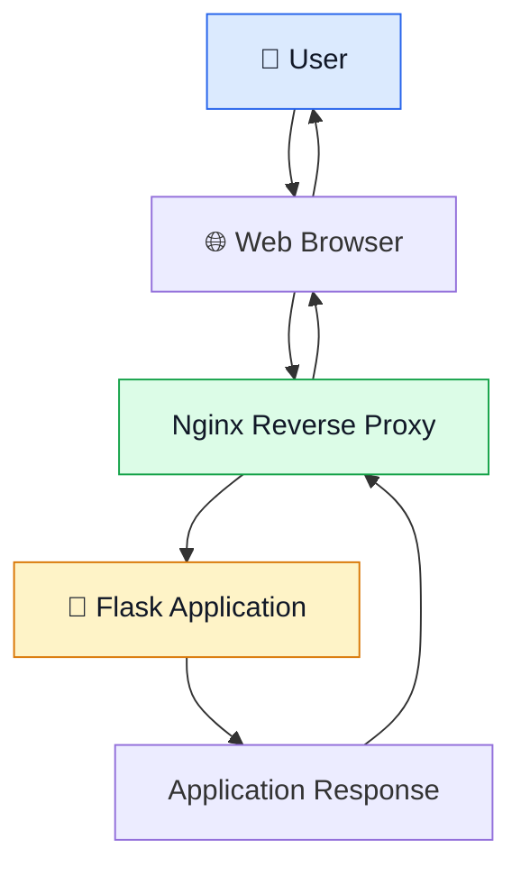
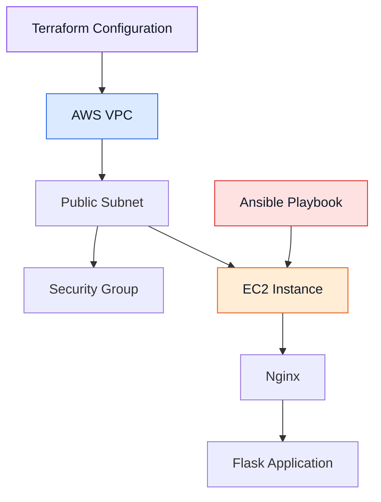

# 📚 Smart Library Management Platform

<p align="center">
  <b>A Cloud-Based Library Management & Deployment Project</b><br>
  Built with Flask, AWS EC2, Nginx, Ansible and Terraform
</p>

<p align="center">
  
  
  
  
  
  
</p>

---

## 📌 Project Overview

The **Smart Library Management Platform** is a web-based project focused on library management and cloud deployment. It combines a Flask web application with AWS infrastructure, Nginx reverse proxy configuration, Ansible automation, and Terraform infrastructure provisioning.

The project demonstrates how a web application and its supporting infrastructure can be deployed and managed using cloud and DevOps technologies.

## 🎯 Objectives

- ☁️ Deploy the web application on AWS EC2.
- 🌐 Configure Nginx as a reverse proxy.
- ⚙️ Automate server configuration using Ansible.
- 🏗️ Provision and manage AWS infrastructure using Terraform.
- 🔧 Organize the project using Git and GitHub.

## 🛠️ Technology Stack

| Technology | Purpose |
|---|---|
| Python | Application programming |
| Flask | Web application framework |
| AWS EC2 | Cloud server hosting |
| Nginx | Web server and reverse proxy |
| Ansible | Configuration automation |
| Terraform | Infrastructure as Code |
| Git & GitHub | Version control and project hosting |

## 🏛️ System Architecture



## ☁️ AWS Infrastructure Architecture



## 🔄 Deployment Workflow

```mermaid
flowchart LR
    A["Write Application"] --> B["Configure AWS Infrastructure"]
    B --> C["Provision Resources with Terraform"]
    C --> D["Configure Server with Ansible"]
    D --> E["Deploy Flask Application"]
    E --> F["Configure Nginx"]
    F --> G["Test Web Application"]
    G --> H["Document Project on GitHub"]

    style A fill:#dbeafe,stroke:#2563eb,color:#111827
    style C fill:#ede9fe,stroke:#7c3aed,color:#111827
    style D fill:#fee2e2,stroke:#dc2626,color:#111827
    style G fill:#dcfce7,stroke:#16a34a,color:#111827
```



## ⚙️ Key Components

### 1. Flask Application
Provides the web application layer.

### 2. AWS EC2
Hosts the application on a cloud-based virtual server.

### 3. Nginx
Acts as a reverse proxy and forwards requests to the Flask application.

### 4. Ansible
Automates server configuration through a playbook.

### 5. Terraform
Defines and manages cloud infrastructure through configuration files.

## 📁 Repository Structure

```text
Smart-Library-Management-Platform/
├── app.py
├── requirements.txt
├── main.tf
├── variables.tf
├── outputs.tf
├── README.md
└── smart-library-playbook.yml
```

*Note: This is the intended project structure. Update the file list to match the files actually committed to the repository.*

## 🚀 Project Workflow

1. Define infrastructure using Terraform.
2. Provision the required AWS resources.
3. Configure the server using Ansible.
4. Deploy the Flask application.
5. Configure Nginx as a reverse proxy.
6. Test the application and document the deployment.

## 🎓 Learning Outcomes

- Understanding cloud infrastructure and AWS EC2.
- Learning Infrastructure as Code with Terraform.
- Automating server configuration with Ansible.
- Understanding Flask application deployment.
- Configuring Nginx reverse proxy.
- Managing project files using GitHub.

## 👩‍💻 Author

**Ishwari Kalokhe**

B.Tech — Artificial Intelligence and Data Science

---

<p align="center">
  ⭐ <b>Smart Library Management Platform</b> ⭐<br>
  <i>Cloud Deployment • Automation • Infrastructure as Code</i>
</p>
